# Store Project

### Requirements

- **NET 10**
- **SQL Server**

---

### Configuration Before Running the Project

Before running the project, configure the connection string in the `appsettings.Development.json` file, located in the `Store.Web` project.

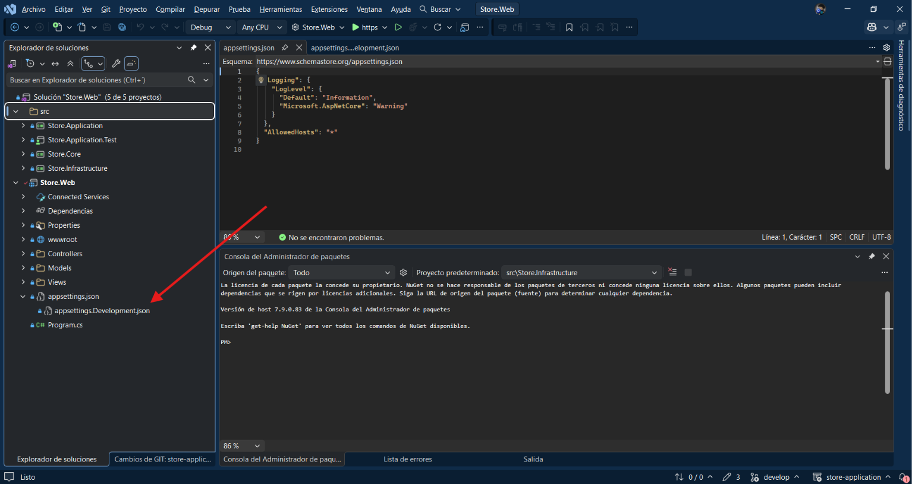

Since we will be running the project in the development environment, we will use `appsettings.Development.json` to configure the database connection.

- **Case 1: Windows Authentication**

  ```json
  {
    "ConnectionStrings": {
      "DefaultConnection": "Server=localhost;Database=StoreTests;Integrated Security=True;TrustServerCertificate=True;Encrypt=True"
    }
  }
  ```

- **Case 2: SQL Server Authentication (Username and Password)**
  ```json
  {
    "ConnectionStrings": {
      "DefaultConnection": "Server=localhost;Database=StoreTests;User Id=your_username;Password=your_password;TrustServerCertificate=True;Encrypt=True"
    }
  }
  ```

**Recommendation:** Only modify the predefined connection string according to your specific environment and authentication method.

**Example Image**:

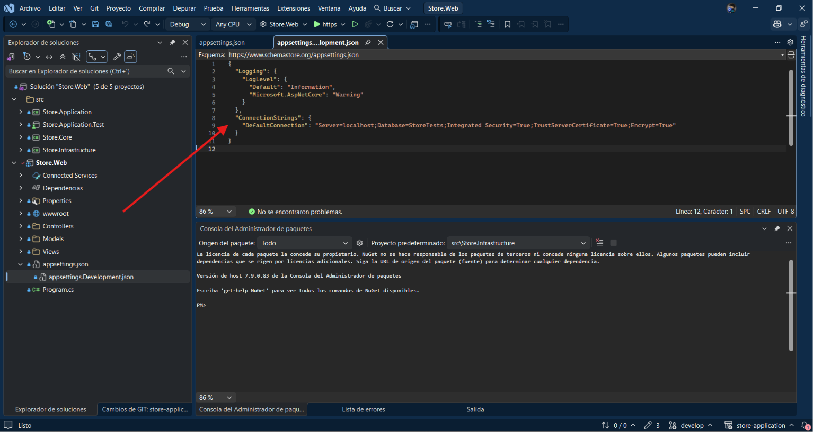

Once this is done, navigate to the **Tools** menu at the top of your IDE.

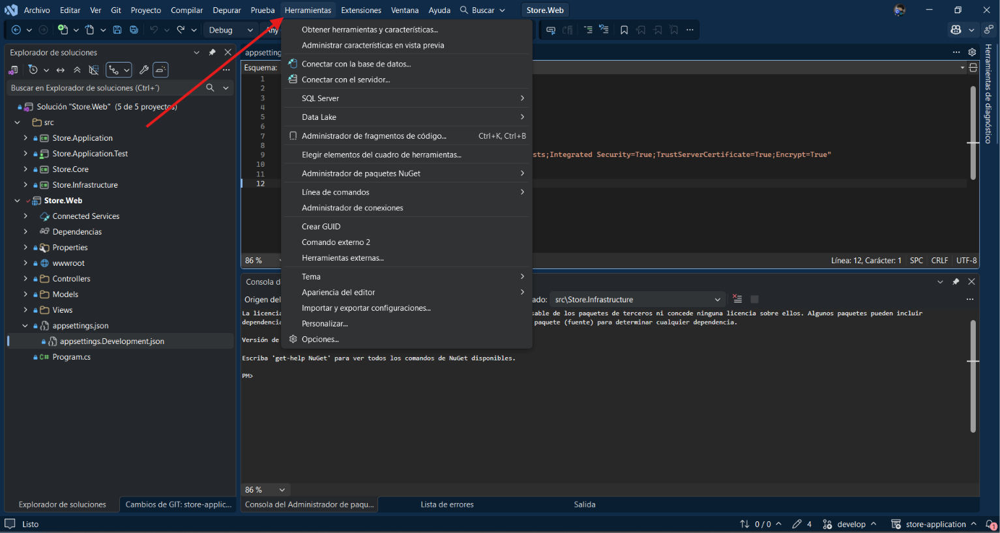

In the **NuGet Package Manager** section.

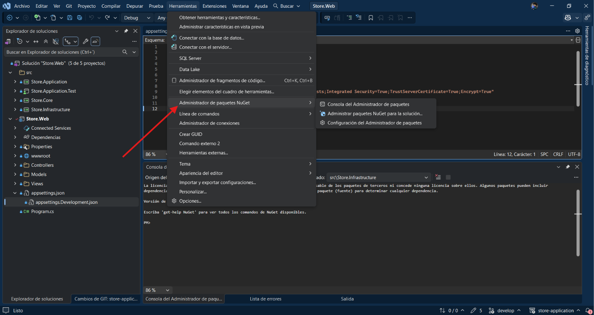

Select **Package Manager Console**.

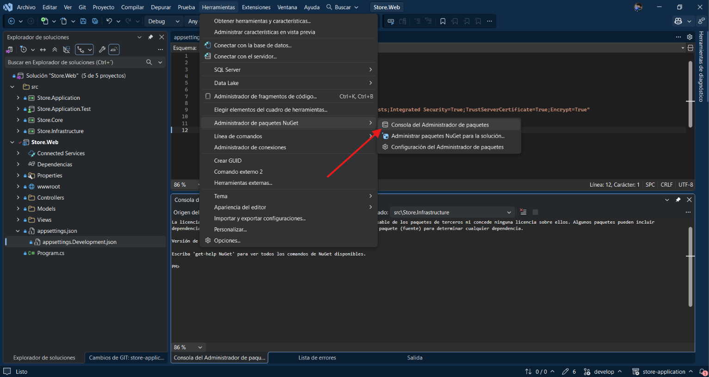

A terminal window will open at the bottom of the IDE.

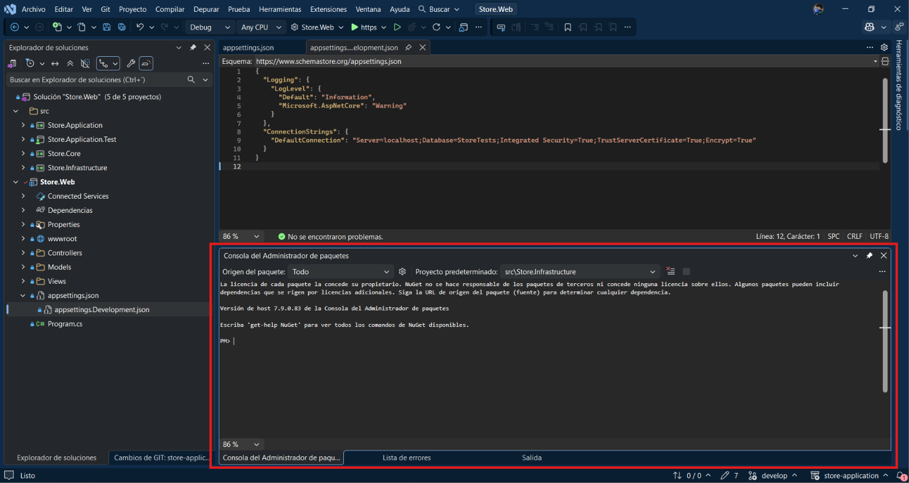

Once there, set **Store.Infrastructure** as the default project.

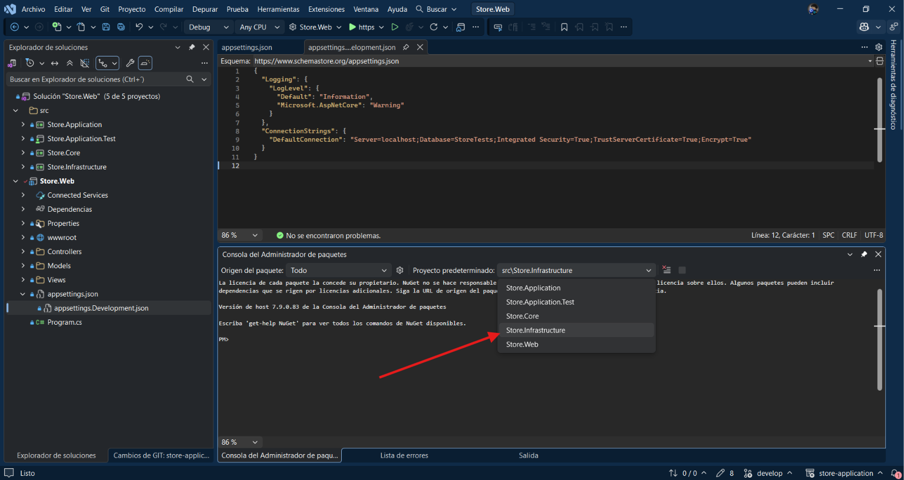

Run the following command in the Package Manager Console to apply the pending Entity Framework Core migrations and update the database.

**Command**:

```powershell
PM> Update-Database
```

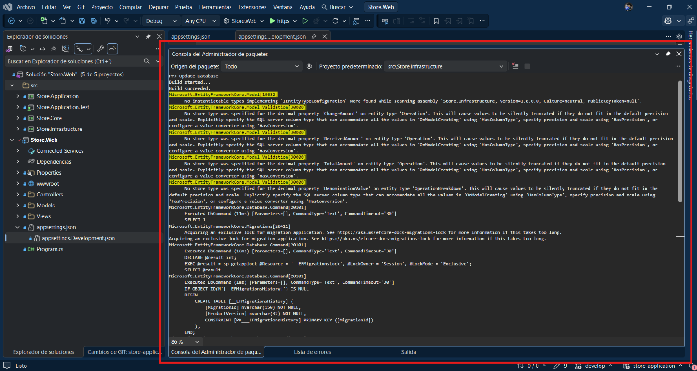

The console will display several commands as Entity Framework Core creates the tables in the database. The important message to look for is **"Done"**, which indicates that the operation has completed successfully.

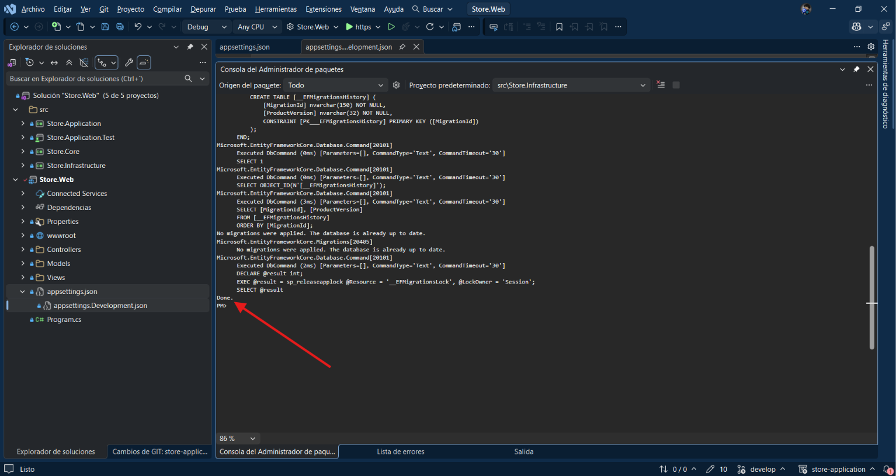

Once this is done, you can run the project by clicking the **HTTPS** button in the toolbar at the top of the IDE.

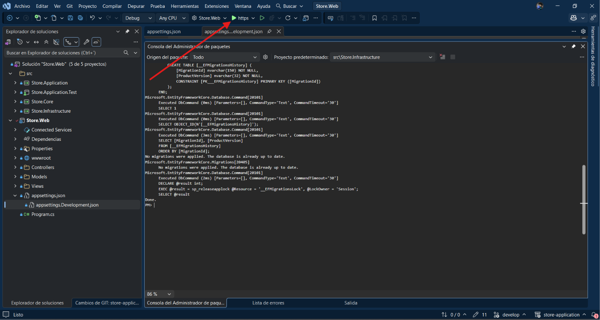

Wait for the project to finish starting. Once it is running, your browser will open automatically and display the login page.

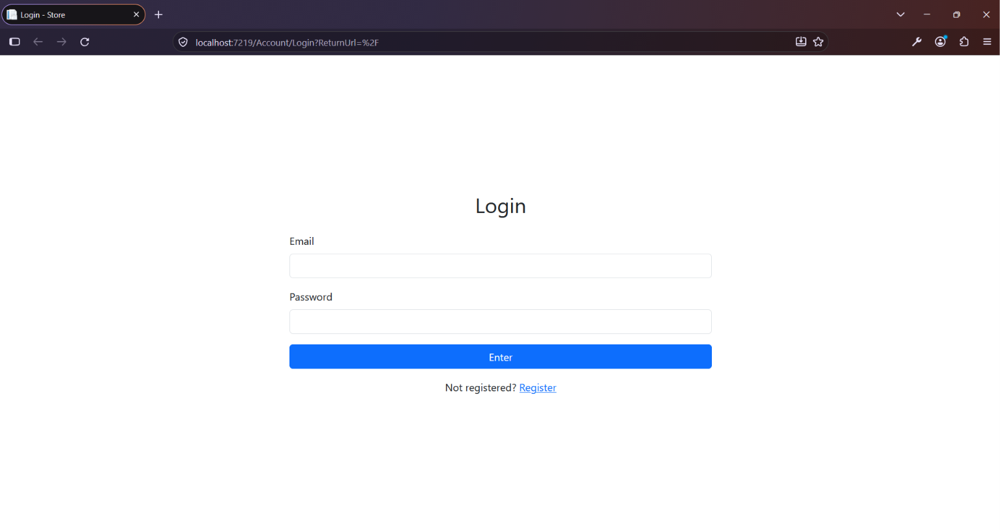

## Credits

- **Developer:** Francisco Emmanuel Rojas Cerón
- **GitHub:** [@Ezvren](https://github.com/ezvren)
